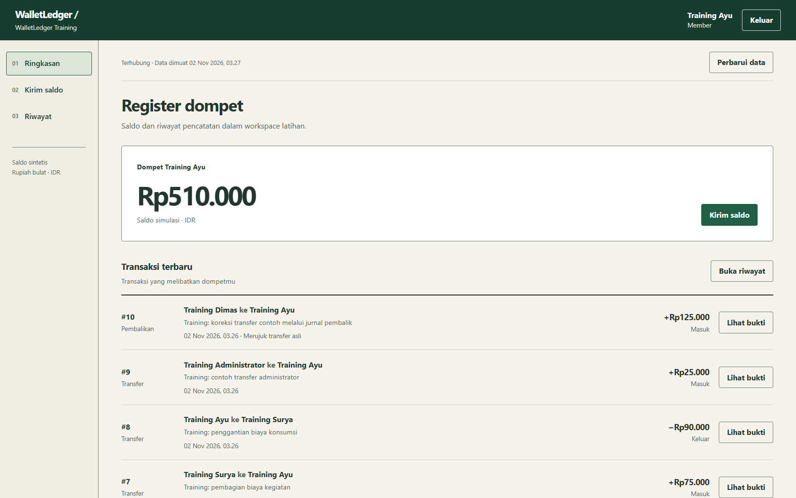
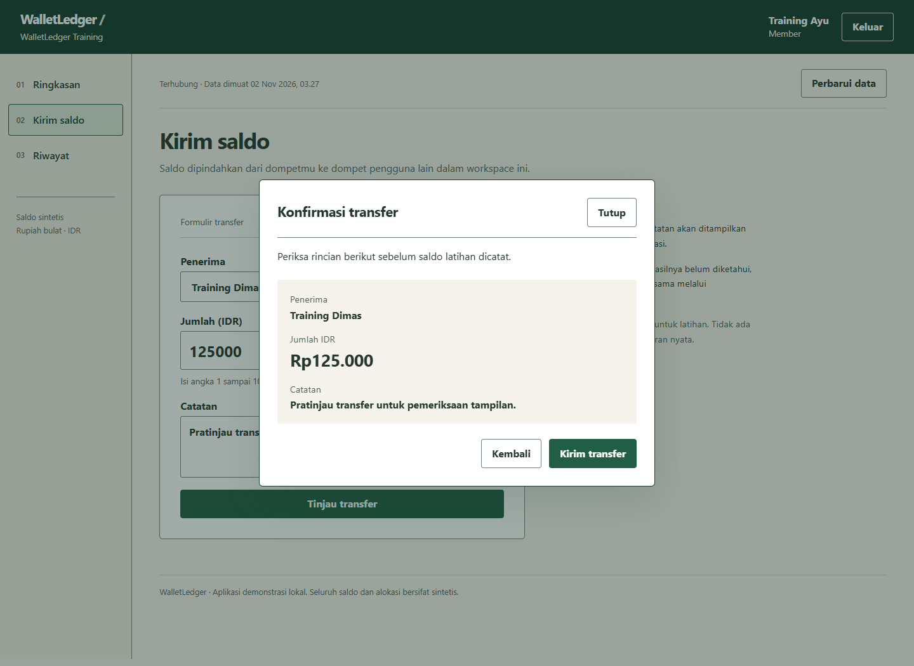
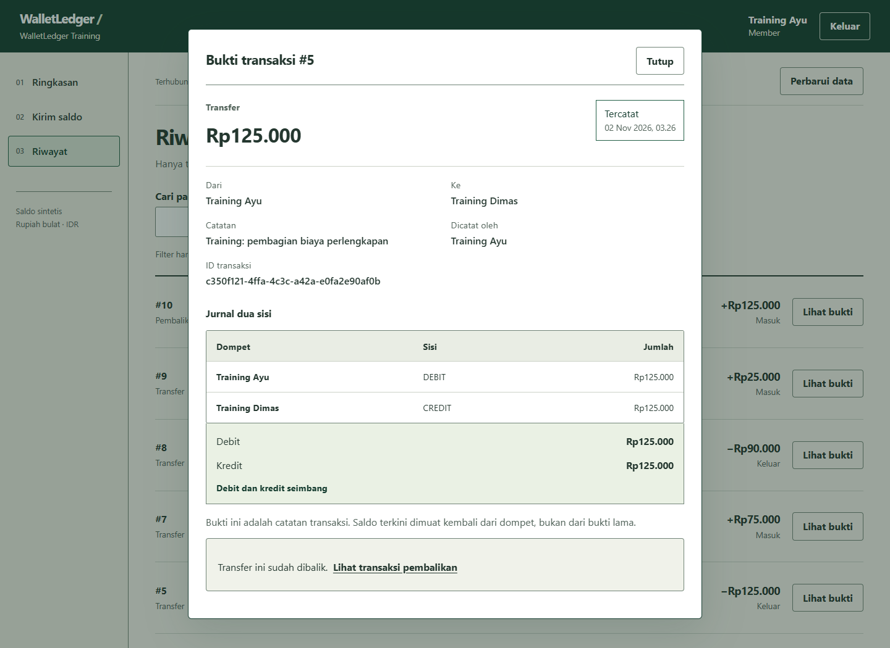
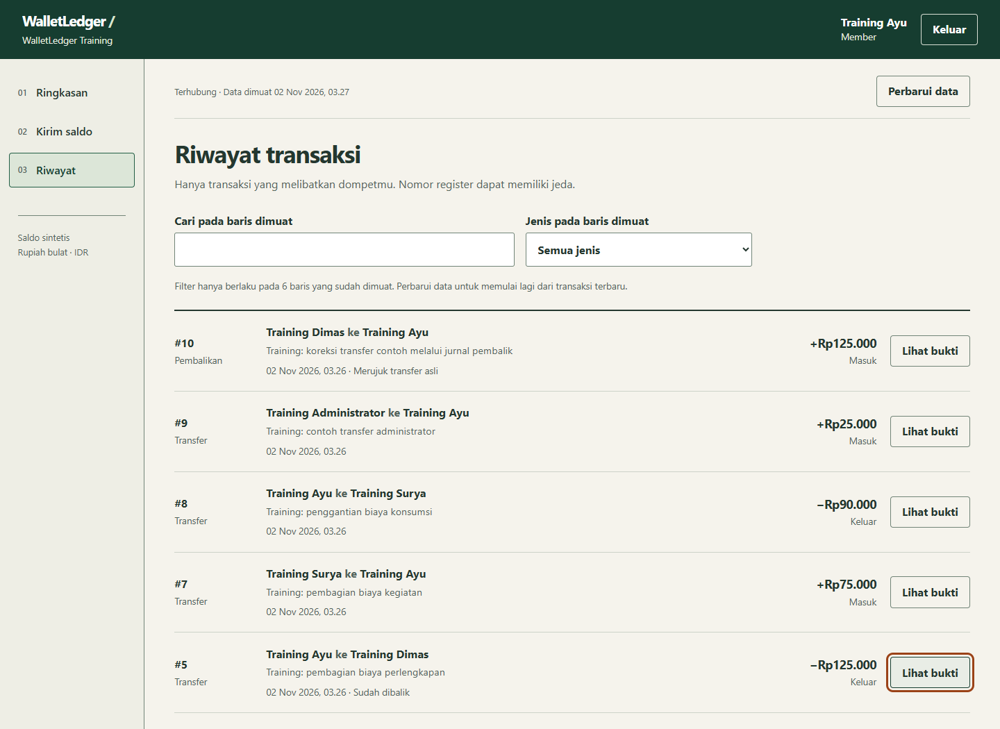
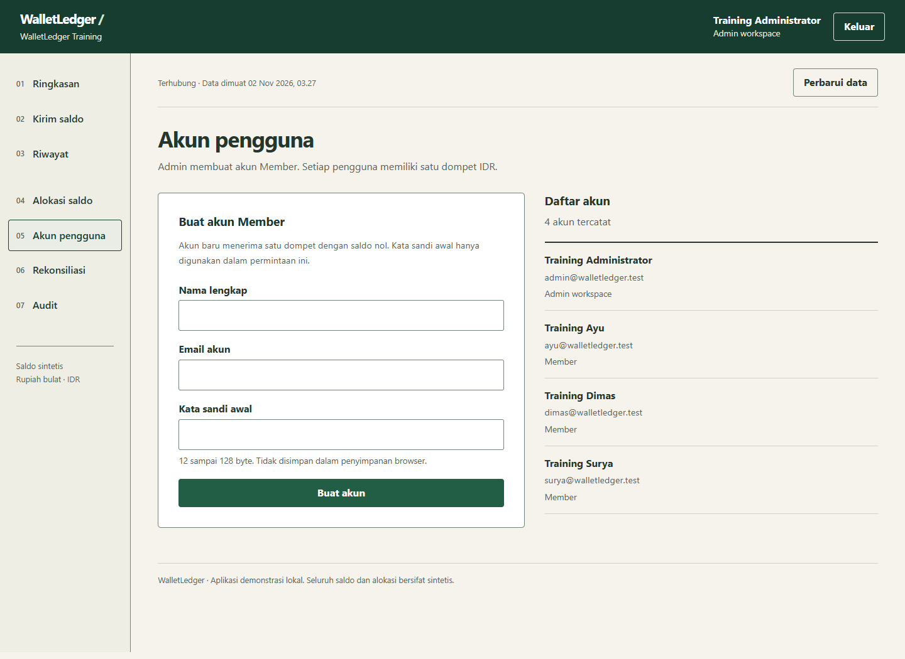
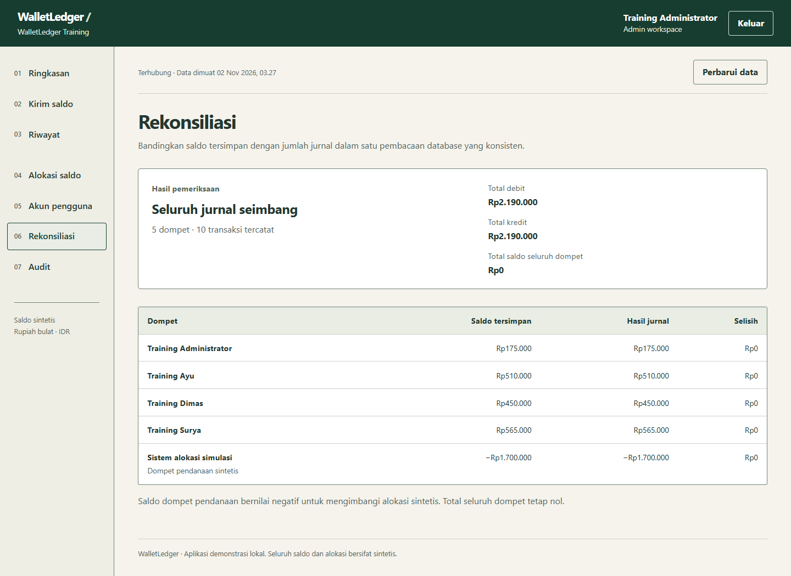
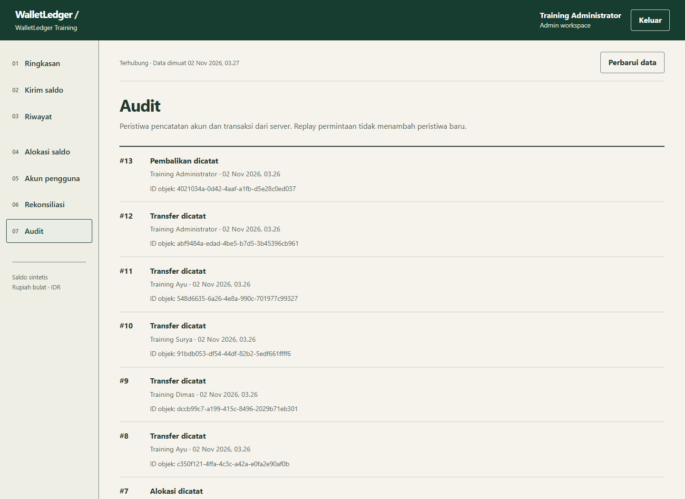
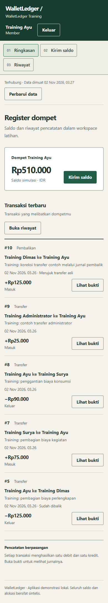

# WalletLedger

Simulator dompet IDR untuk mempelajari transfer yang konsisten: saldo pengirim dan penerima, jurnal debit/kredit, serta bukti request disimpan dalam satu transaksi PostgreSQL. Pengguna dapat melihat saldo dan mengirim transfer. Administrator membuat akun, mengalokasikan saldo latihan, memeriksa rekonsiliasi, dan membalik transfer melalui jurnal baru.

Backend memakai **Go dan pgx**, frontend **React dan TypeScript**, dengan **PostgreSQL 17 dan Docker**. Seluruh nilai uang berupa integer rupiah; API mengirim angka sebagai string desimal agar nominal tidak melewati pembulatan JavaScript.



Screenshot berasal dari aplikasi yang dijalankan dengan data **Training sintetis**. Panduan membaca dan membuat implementasinya tersedia di [panduan kode](docs/PANDUAN-KODE.md), [backend per file](docs/BACKEND-GUIDE.md) dan [frontend per file](docs/FRONTEND-GUIDE.md).

## Jalankan

Prasyarat: Docker Desktop dengan Linux containers dan PowerShell. Port 8170 untuk web dan 5462 untuk PostgreSQL harus tersedia.

```powershell
git clone https://github.com/zalamanga/wallet-ledger.git
cd wallet-ledger
.\scripts\Start.ps1
```

Buka **http://127.0.0.1:8170**. Startup membuat dua password database acak dan secret receipt HMAC stabil dalam `.env`, menjalankan migrasi dengan role pemilik schema, menyiapkan role runtime dengan hak data yang terbatas, lalu menyalakan API dan Nginx. Role API tidak mempunyai hak membuat schema, database atau temporary table.

Pilih salah satu cara memulai workspace yang masih kosong:

- **Data sendiri:** isi formulir setup untuk membuat administrator, lalu buat pengguna dan alokasi saldo dari aplikasi.
- **Demo:** sebelum mengisi setup, jalankan perintah berikut dengan Python 3. Tidak ada dependency Python tambahan.

```powershell
python scripts/seed-demo.py --confirm-synthetic
```

Demo membuat empat akun, lima wallet termasuk sumber saldo simulasi, dan sepuluh transaksi dengan contoh pembalikan. Password acak tersimpan di `.local/LOCAL-CREDENTIALS.txt`, yang diabaikan Git. Seed menolak workspace yang sudah ada tanpa checkpoint miliknya. Langkah yang hasilnya belum pasti menghentikan proses untuk diperiksa.

```powershell
.\scripts\Stop.ps1
.\scripts\Start.ps1 -NoBuild
```

Stop mempertahankan volume. Jika `.env` hilang sementara volume masih ada, pulihkan credential asli. Startup menolak membuat password pengganti untuk data yang sudah ada.

## Coba alurnya

1. Masuk sebagai Member. Periksa saldo dan transaksi yang melibatkan wallet sendiri.
2. Pilih penerima, isi nominal rupiah dan catatan. Tinjau dokumen konfirmasi, lalu konfirmasikan transfer.
3. Buka detail transaksi. Dua baris jurnal memiliki total debit dan kredit yang sama.
4. Coba nominal melebihi saldo. API menolak seluruh transaksi; saldo dan jurnal tetap konsisten.
5. Masuk sebagai Admin. Buat akun, alokasikan saldo latihan, dan buka rekonsiliasi untuk membandingkan saldo tersimpan dengan jurnal.
6. Balik transfer dengan alasan. Aplikasi membuat transaksi pembalik; transfer asal dan jurnalnya tetap tersedia. Penerima asal harus memiliki saldo yang cukup.

| Situasi | Perilaku server |
|---|---|
| Dua transfer berebut saldo yang sama | Wallet dikunci dalam urutan UUID; saldo diperiksa setelah lock |
| Koneksi hilang setelah request dikirim | UI mempertahankan key, pemilik dan body asli untuk diperiksa/diulang |
| Request yang sama dicoba lagi | Receipt mengembalikan hasil asal tanpa jurnal atau debit kedua |
| Key lama dipakai dengan nominal/penerima berbeda | 409 `IDEMPOTENCY_CONFLICT` |
| Saldo kurang lalu pengguna menerima dana | Retry key penolakan lama tetap mengembalikan penolakan asal; tindakan baru memakai key baru |
| Cookie berubah menjadi akun lain sebelum POST | Expected identity diperiksa sebelum request diproses |
| Pembalikan dicoba dua kali | Server mempertahankan satu pembalikan yang sah |

Receipt adalah hasil historis. Sesudah sukses atau replay, UI mengambil saldo terbaru dari API. Intent yang belum pasti dapat disimpan per tab/pengguna dalam SessionStorage, dengan isi nominal dan catatan; password, cookie dan token CSRF tidak disimpan di sana. Pembuatan akun yang memuat password hanya mempertahankan intent di memori tab. Penulisan memerlukan koneksi online.

## Tampilan lain

<details>
<summary>Konfirmasi, jurnal, history dan pemeriksaan Admin</summary>















</details>

## REST API

Schema OpenAPI: **http://127.0.0.1:8170/api/openapi.json**. URL server pada schema adalah `/api`.

| Endpoint | Fungsi |
|---|---|
| `/auth/*` | Setup, login, sesi, CSRF, logout |
| `GET /wallets`, `GET /wallets/{id}` | Wallet yang boleh dibaca akun saat ini |
| `GET /people`, `POST /people` | Daftar penerima; pembuatan akun oleh Admin |
| `POST /transfers` | Transfer dari wallet pengguna saat ini |
| `POST /allocations` | Alokasi saldo simulasi oleh Admin |
| `GET /transactions`, `GET /transactions/{id}` | Riwayat dan dua baris jurnal |
| `POST /transactions/{id}/reverse` | Pembalikan transfer oleh Admin |
| `GET /reconciliation`, `GET /audit` | Pemeriksaan saldo/jurnal dan jejak tindakan Admin |

[API](docs/API.md) menjelaskan cookie, CSRF, expected identity, idempotency, bentuk nominal, dan contoh error. Angka contoh `"50000"` berarti lima puluh ribu rupiah, dengan currency tunggal IDR.

## Dokumentasi dan pengujian

- [Mulai dari nol dan jelaskan saat interview](docs/PANDUAN-KODE.md)
- [Backend: schema, fungsi dan transaksi](docs/BACKEND-GUIDE.md)
- [Frontend: form, konfirmasi dan pemulihan request](docs/FRONTEND-GUIDE.md)
- [Arsitektur dan batas konsistensi](docs/ARCHITECTURE.md)
- [Diagram alur](docs/FLOWS.md)
- [Menjalankan, menyimpan data dan troubleshooting](docs/OPERATIONS.md)
- [Asal source dan dependency](docs/ORIGIN.md)
- [Hasil verifikasi yang dijalankan](docs/VERIFICATION.md)

```powershell
.\scripts\Test.ps1
```

Suite backend memakai PostgreSQL nyata dan database UUID yang terisolasi. Pengujian browser memakai frontend production serta HTTP nyata pada server test 8171. CI menjalankan suite tersebut, role runtime terbatas, dan build/health Compose. Hasil yang sudah dijalankan dicatat di dokumen verifikasi; keberadaan file test sendiri bukan bukti lulus.

## Batas simulasi

Satu workspace dengan Admin dan Member. Kredit sumber simulasi berpasangan dengan debit pada wallet sistem sehingga total seluruh saldo tetap nol; wallet pengguna harus nonnegatif. Ini model kredit-minus-debit untuk seluruh wallet, dengan sumber simulasi sebagai counter-account, bukan laporan akuntansi bank lengkap.

Nilai alokasi/transfer per request maksimal 1.000.000.000 rupiah dan saldo pengguna maksimal 1.000.000.000.000 rupiah. Riwayat memakai pagination berbasis sequence; halaman terpisah bukan snapshot selama ada transaksi bersamaan. Tidak ada integrasi uang nyata atau payment gateway. Deployment publik memerlukan keputusan operasional tambahan seperti TLS, pengelolaan akun, backup/restore teruji dan monitoring.
